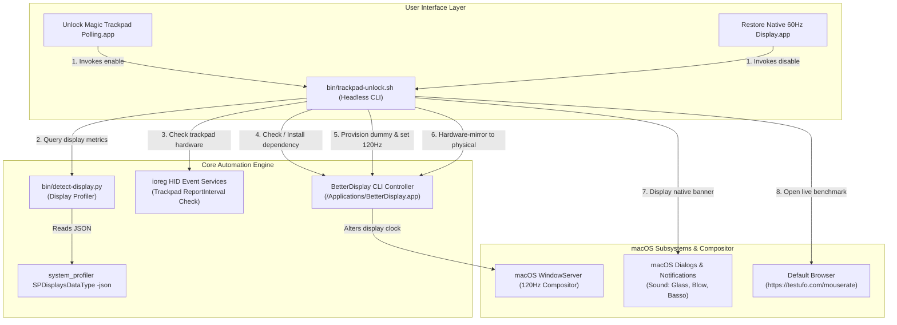
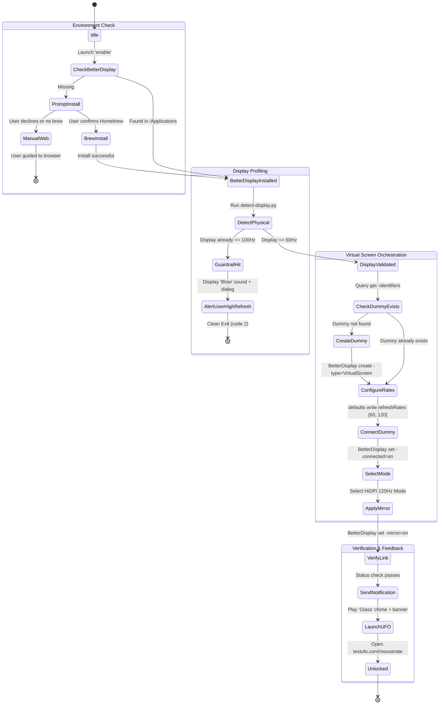
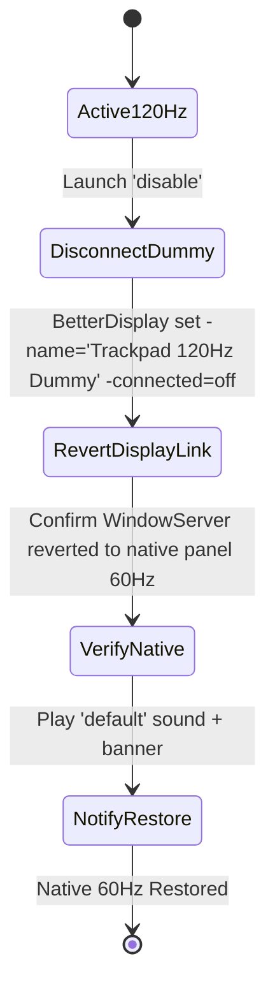

# Engineering Plan: Magic Trackpad Higher Polling Rate Unlock

> **Status:** APPROVED FOR EXECUTION  
> **Version:** 2.0.0  
> **Target OS:** macOS 13 (Ventura), macOS 14 (Sonoma), macOS 15 (Sequoia) or later  
> **Architecture:** Apple Silicon (ARM64) & Intel (x86_64)  
> **Upstream Dependency:** [BetterDisplay](https://betterdisplay.pro) (v2.x / v3.x)  

---

## 1. Executive Summary & Technical Thesis

### 1.1 The Problem: The 60Hz VSYNC Polling Throttling Bottleneck
The Apple Magic Trackpad (Magic Trackpad 2 & 3, both Lightning and USB-C models) hardware controller transmits touch and movement reports over Bluetooth with a packet interval of `ReportInterval = 8000 µs` (8.0 milliseconds), corresponding to a native hardware report frequency of **125Hz** (fluctuating dynamically between **90Hz and 125Hz** during active gesture input). When plugged in directly via USB, it delivers a steady **125Hz**.

However, on macOS systems connected to a **60Hz display** (including the Apple Studio Display, LG UltraFine 4K/5K, Dell/ASUS 4K 60Hz panels, and non-ProMotion MacBooks or headless Mac minis), macOS's `WindowServer` compositor and browser rendering engines (Blink, WebKit, Gecko) synchronize their event loops and cursor dispatch pipeline directly to the primary display's VSYNC rate (16.66ms per frame).

As a result:
* Touch input packets arriving at ~8ms intervals are coalesced and clamped to the 60Hz render cadence.
* Browser `pointermove` and `mousemove` events fire at a maximum of **60 events per second**.
* Cursor tracking latency increases to **~16.7ms**, introducing visible micro-stutter and cursor lag despite the trackpad hardware having dispatched two distinct coordinate packets during that same frame window.

```
Hardware Polling (Trackpad): [ 8ms ][ 8ms ][ 8ms ][ 8ms ][ 8ms ][ 8ms ] (125Hz)
                                |      |      |      |      |      |
macOS WindowServer (60Hz):     [     16.66ms     ][     16.66ms     ] (60Hz)
Dispatched Pointer Events:     ( Event 1 )        ( Event 2 )       <-- 50% packets coalesced/lost
```

### 1.2 The Solution: 120Hz Compositor Promotion via Virtual Mirroring
By creating a high-performance virtual dummy screen inside macOS configured for a **120Hz refresh rate** and hardware-mirroring that dummy onto the physical 60Hz monitor:
1. `WindowServer` establishes its primary display link clock at **120Hz** (8.33ms per frame).
2. The operating system and web browsers immediately double their event loop tick rate from 60Hz to 120Hz.
3. Every individual 125Hz/8ms report from the Magic Trackpad now matches an active frame tick, immediately unlocking real-time **90–125Hz event dispatching**.
4. The physical 60Hz display continues refreshing pixels comfortably at its native 60Hz hardware capability (dropping redundant intermediary video frames), while touch, gesture, and cursor pipeline latency drops from **~16.7ms to ~8.3ms**.

```
Hardware Polling (Trackpad): [ 8ms ][ 8ms ][ 8ms ][ 8ms ][ 8ms ][ 8ms ] (125Hz)
                                |      |      |      |      |      |
Virtual Dummy (120Hz):         [  8.33ms  ][  8.33ms  ][  8.33ms  ] (120Hz Compositor Link)
Dispatched Pointer Events:     ( Event 1  )( Event 2  )( Event 3  ) <-- 100% packets processed live!
Physical Display (60Hz):       [        16.66ms        ][  ...     ] (Presents alternate frames)
```

### 1.3 Objective of this Utility
Package this configuration technique into a frictionless, viral-ready, open-source macOS utility titled **`magic-trackpad-higher-polling-rate-unlock`**:
* **One-Click Native App:** Double-click `Unlock Magic Trackpad Polling.app` to activate, and `Restore Native 60Hz Display.app` to deactivate.
* **Intelligent Auto-Profiling:** Automatically detects screen resolution, aspect ratio (16:9, 16:10, 3:2, 21:9), and refresh rate without manual user configuration.
* **ProMotion Guardrail:** Detects if the current monitor is already running at $\ge 100\text{Hz}$ (e.g. MacBook Pro Liquid Retina XDR screen or 144Hz external gaming display), provides an informative alert, and exits cleanly without creating redundant dummies.
* **Zero Proprietary Binary Shipping:** Fully compliant open-source distribution. Leverages [BetterDisplay](https://betterdisplay.pro) for virtual display driver bridging; offers automated Homebrew cask installation (`brew install --cask betterdisplay`) if absent.
* **Instant Visual Proof:** Native top-right Notification Center alerts with custom branding and sound cues, automatically opening `https://testufo.com/mouserate` in the default browser so users see their live 90–125Hz polling rate immediately.

---

## 2. Architecture & Data Flow

### 2.1 Component Interaction Diagram



### 2.2 Activation Lifecycle State Machine



### 2.3 Deactivation (Restore) Lifecycle State Machine



---

## 3. Hardware, OS & System Boundary Constraints

### 3.1 Operating System & Silicon Boundaries
* **Supported macOS Versions:** macOS 13 (Ventura), macOS 14 (Sonoma), macOS 15 (Sequoia), and future releases.
* **Supported Architectures:** Apple Silicon (M1, M1 Pro/Max/Ultra, M2 series, M3 series, M4 series) and Intel Macs with Metal-compatible GPUs.
* **Compositor Promotion Principle:** The 120Hz display link promotion is an intrinsic behavior of Apple's Metal-based `WindowServer` architecture. When any connected display (physical or virtual) demands a 120Hz refresh cadence, `WindowServer` steps up its internal scheduling clock to 120Hz to satisfy the highest refresh rate display in the desktop topology.

### 3.2 Trackpad Hardware Specifications
* **Apple Magic Trackpad 2 & 3:**
  * Bluetooth HID Vendor ID: `0x004c` (Apple) or `0x05ac`
  * Product ID: `0x0265`, `0x0324`, `0x0343`
  * Raw Hardware Report Interval: `ReportInterval = 8000 µs` ($125\text{Hz}$)
* **Verification Query:**
  ```bash
  ioreg -r -c AppleDeviceManagementHIDEventService | grep -A 5 -i "magic trackpad"
  ```
  Expected output confirms:
  ```text
  "Product" = "Magic Trackpad"
  "ReportInterval" = 8000
  ```

### 3.3 Dependency Boundaries (Zero Proprietary Binary Shipping)
* **License Compliance:** `BetterDisplay.app` is proprietary software developed by Waydabber. **Under no circumstances should any `BetterDisplay.app` binaries, frameworks, or dylibs be checked into this Git repository.**
* **Interaction Contract:** All orchestration is performed via:
  1. The official CLI interface `/Applications/BetterDisplay.app/Contents/MacOS/BetterDisplay`.
  2. The macOS user preference system `pro.betterdisplay.BetterDisplay` via `/usr/bin/defaults`.
* **Automated Remediation:** If `BetterDisplay.app` is missing from `/Applications`, the script programmatically offers to run:
  ```bash
  brew install --cask betterdisplay
  ```
  or directs the user to the verified upstream download page (`https://github.com/waydabber/BetterDisplay/releases`).

### 3.4 Display Guardrail Boundary
* **Pre-Flight Condition:** If the primary physical display is already running at $\ge 100\text{Hz}$ (e.g. built-in 120Hz ProMotion display on 14″/16″ MacBook Pro, or 120Hz/144Hz/240Hz external gaming monitor), the utility MUST NOT create a virtual dummy.
* Creating a 120Hz dummy on a panel that is already running at 120Hz provides zero polling benefit, wastes GPU memory, and could disrupt native VRR/ProMotion timing.

---

## 4. Repository Structure & File Layout

```
magic-trackpad-higher-polling-rate-unlock/
├── .gitignore                          # Standard macOS ignores (.DS_Store, build artifacts)
├── LICENSE                            # MIT License
├── Makefile                           # Automated build, bundle, test, and install script
├── PLAN.md                            # Comprehensive Engineering Plan & Architecture Spec
├── README.md                          # Viral-ready public GitHub documentation & guide
├── apps/                              # Pre-compiled distributable double-clickable .app bundles
│   ├── Unlock Magic Trackpad Polling.app/
│   │   └── Contents/
│   │       ├── Info.plist             # App bundle configuration (LSUIElement, icons, version)
│   │       ├── MacOS/applet           # Executable launcher (compiled osacompile stub)
│   │       └── Resources/
│   │           ├── Scripts/main.scpt  # Launcher script pointing to embedded or system engine
│   │           ├── applet.icns        # High-res 120Hz trackpad unlock icon
│   │           └── bin/               # Self-contained embedded engine copies
│   │               ├── trackpad-unlock.sh
│   │               └── detect-display.py
│   └── Restore Native 60Hz Display.app/
│       └── Contents/
│           ├── Info.plist
│           ├── MacOS/applet
│           └── Resources/
│               ├── Scripts/main.scpt
│               ├── applet.icns        # High-res native restore icon
│               └── bin/
│                   ├── trackpad-unlock.sh
│                   └── detect-display.py
├── bin/                               # Standalone headless CLI executables
│   ├── detect-display.py              # Pure Python display profiler and 60Hz guardrail check
│   └── trackpad-unlock.sh             # Core bash orchestration script
├── src/                               # AppleScript source code for applet compilation
│   ├── unlock.applescript             # Clean AppleScript source for Unlock applet
│   └── restore.applescript            # Clean AppleScript source for Restore applet
├── assets/                            # Brand assets and visual demo media
│   ├── icon-unlock.png                # Source artwork for Unlock app icon (1024x1024)
│   ├── icon-restore.png               # Source artwork for Restore app icon (1024x1024)
│   ├── applet-unlock.icns             # Multi-resolution macOS ICNS bundle
│   ├── applet-restore.icns            # Multi-resolution macOS ICNS bundle
│   └── demo-comparison.gif            # Visual comparison (60Hz vs 125Hz on TestUFO)
└── tests/                             # Test suite and mock verification data
    ├── fixtures/                      # Mock outputs from system_profiler
    │   ├── studio_display_60hz.json
    │   ├── macbook_promotion_120hz.json
    │   ├── dual_monitor_setup.json
    │   └── active_mirror_setup.json
    └── test_detect_display.py         # Unit tests validating detection logic against fixtures
```

---

## 5. Detailed Component Specifications

### 5.1 Component A: Display Profiler (`bin/detect-display.py`)

A zero-dependency Python script using macOS's built-in `/usr/bin/python3` that interrogates `system_profiler SPDisplaysDataType -json` to extract precise display metrics.

#### 5.1.1 Command-Line Interface Specification
```
Usage: /usr/bin/python3 bin/detect-display.py [OPTIONS]

Options:
  --json                  Output complete display metrics as formatted JSON (default).
  --field <FIELD_NAME>    Output only the specific field value (e.g. refresh_rate, name, aspect_w).
  --target-name <NAME>    Filter by specific physical display name (useful for multi-monitor).
  --check-guardrail       Exit code 0 if primary display is 60Hz; exit code 2 if already >= 100Hz.
  --debug                 Print raw parsed display trees to stderr for troubleshooting.
  -h, --help              Show help message and exit.
```

#### 5.1.2 Exit Codes
| Exit Code | Meaning |
| :--- | :--- |
| `0` | Success: Target physical display detected and is running at $\le 75\text{Hz}$ (qualified for unlock). |
| `1` | Error: No active physical display found or unable to parse `system_profiler` output. |
| `2` | Guardrail Hit: Target display is already running at $\ge 100\text{Hz}$ (unlock unneeded). |

#### 5.1.3 JSON Output Schema
```json
{
  "status": "ok",
  "display_name": "Studio Display",
  "is_builtin": false,
  "refresh_rate": 60,
  "is_60hz": true,
  "is_high_refresh": false,
  "native_width": 5120,
  "native_height": 2880,
  "logical_width": 2560,
  "logical_height": 1440,
  "aspect_w": 16,
  "aspect_h": 9,
  "aspect_ratio_str": "16:9",
  "mirror_state": "none",
  "vendor_id": "0x0610",
  "raw_resolution_str": "5120 x 2880 @ 60.00Hz"
}
```

#### 5.1.4 Critical Parsing & Exclusion Logic
1. **Virtual Screen Dummy Filtering:**
   * BetterDisplay virtual screens register under vendor ID `0x896` (decimal `2198`).
   * Any display in `spdisplays_ndrvs` whose `_spdisplays_display-vendor-id` is `"896"` or `"2198"` or whose name contains `"Dummy"`, `"Virtual"`, or matches existing dummy labels MUST be excluded from physical display candidate evaluation.
2. **Handling Already-Active Mirrors:**
   * When the 120Hz dummy is already running and mirrored, `system_profiler` marks the dummy as `spdisplays_master_mirror` with `spdisplays_main: spdisplays_yes`, while the physical monitor is marked as `spdisplays_hardware_mirror`.
   * The profiler must inspect the underlying physical screen (e.g. `Studio Display`) to evaluate the true physical hardware panel, rather than mistakenly inspecting the active 120Hz dummy and concluding the physical display is natively 120Hz.
3. **Aspect Ratio Calculation & Normalization:**
   * Compute $\text{GCD}(\text{native\_width}, \text{native\_height})$.
   * Map to standard aspect ratios:
     * $16:9$ (e.g. $5120\times2880$, $3840\times2160$, $2560\times1440$, $1920\times1080$)
     * $16:10$ (e.g. $2560\times1600$, $1920\times1200$, $3840\times2400$)
     * $3:2$ (e.g. $4320\times2880$, $3000\times2000$)
     * $21:9$ / $43:18$ (UltraWide panels e.g. $3440\times1440$, $5120\times2160$)
     * $32:9$ (Super UltraWide e.g. $5120\times1440$)

---

### 5.2 Component B: Core Automation Engine (`bin/trackpad-unlock.sh`)

The core headless POSIX/Bash engine orchestrating system checks, BetterDisplay CLI commands, user defaults, and native notifications.

#### 5.2.1 CLI Syntax and Subcommands
```bash
bin/trackpad-unlock.sh [COMMAND] [OPTIONS]

COMMANDS:
  enable            Detect display, provision 120Hz dummy, activate mirror, notify, launch TestUFO.
  disable           Disconnect virtual dummy, restore native 60Hz display, notify.
  status            Print JSON status report of physical displays, dummies, and trackpad HID rate.
  test              Run live diagnostic check on trackpad HID packets and report interval.
  install-deps      Automate Homebrew installation of BetterDisplay cask.
  cleanup           Completely delete 'Trackpad 120Hz Dummy' from BetterDisplay preferences.

OPTIONS:
  --force           Bypass the 60Hz guardrail check (force dummy creation).
  --headless        Suppress all GUI dialogs and browser popups (ideal for CLI automation).
  --no-browser      Enable 120Hz mirror but do not automatically open TestUFO.
  --target <NAME>   Specify target physical display name explicitly.
  --json            Output machine-readable JSON status messages to stdout.
  -v, --verbose     Enable detailed debug logging to stderr.
  -h, --help        Show usage information and exit.
```

#### 5.2.2 Exit Codes Reference Table
| Exit Code | Constant Name | Description |
| :--- | :--- | :--- |
| `0` | `EXIT_SUCCESS` | Command completed successfully. |
| `1` | `EXIT_GENERAL_ERROR` | Unspecified execution or runtime error. |
| `2` | `EXIT_ALREADY_HIGH_REFRESH` | Display is already running at $\ge 100\text{Hz}$ (guardrail triggered). |
| `3` | `EXIT_BETTERDISPLAY_MISSING` | BetterDisplay is not installed and user declined installation. |
| `4` | `EXIT_NO_PHYSICAL_DISPLAY` | Display detection script failed to identify a physical panel. |
| `5` | `EXIT_DUMMY_CREATION_FAILED` | BetterDisplay CLI failed to create the virtual screen. |
| `6` | `EXIT_MODE_SELECTION_FAILED` | Failed to locate a suitable 120Hz HiDPI display mode. |
| `7` | `EXIT_MIRROR_FAILED` | BetterDisplay failed to establish hardware mirror link. |
| `8` | `EXIT_PERMISSION_DENIED` | macOS Screen Recording or Accessibility permission required. |
| `9` | `EXIT_NO_TRACKPAD_DETECTED` | Informational: Process completed, but no Magic Trackpad detected. |

#### 5.2.3 Core Function Signatures & Implementation Logic

##### 1. `check_dependencies(headless_mode)`
* Checks for binary at `/Applications/BetterDisplay.app/Contents/MacOS/BetterDisplay`.
* If missing:
  * In `--headless` mode: prints error to stderr and exits with code `3`.
  * In GUI mode: triggers an AppleScript dialog:
    ```applescript
    display dialog "BetterDisplay is required to create the 120Hz virtual mirror that unlocks Magic Trackpad polling rates.\n\nWould you like to install it automatically via Homebrew?" with title "Magic Trackpad Polling Unlock" buttons {"Download Manually", "Cancel", "Install via Homebrew"} default button "Install via Homebrew" with icon caution
    ```
  * If user selects "Install via Homebrew": verifies `brew` exists (`/opt/homebrew/bin/brew` or `/usr/local/bin/brew`) and executes `brew install --cask betterdisplay`.
  * If user selects "Download Manually": opens `https://betterdisplay.pro` and exits cleanly.

##### 2. `ensure_betterdisplay_running()`
* Checks if `BetterDisplay` is currently running via `pgrep -x BetterDisplay`.
* If not running:
  * Launches application silently in background: `open -a BetterDisplay --hide`.
  * Polls `/Applications/BetterDisplay.app/Contents/MacOS/BetterDisplay get -identifiers` with a 5-second timeout until the daemon is responsive.

##### 3. `provision_virtual_dummy(aspect_w, aspect_h)`
* Constant Dummy Name: `"Trackpad 120Hz Dummy"`.
* Inspects existing devices using `$BETTERDISPLAY get -identifiers`.
* If a dummy named `"Trackpad 120Hz Dummy"` does not exist:
  ```bash
  $BETTERDISPLAY create \
    -type=VirtualScreen \
    -virtualScreenName="Trackpad 120Hz Dummy" \
    -aspectWidth="$aspect_w" \
    -aspectHeight="$aspect_h"
  ```
* Re-queries identifiers to extract the assigned numeric `tagID` for the new dummy:
  ```bash
  TAG_ID=$($BETTERDISPLAY get -identifiers | python3 -c "
import sys, json
data = json.load(sys.stdin)
for d in (data if isinstance(data, list) else [data]):
    if d.get('name') == 'Trackpad 120Hz Dummy':
        print(d.get('tagID'))
        break
")
  ```

##### 4. `inject_120hz_refresh_rates(tag_id)`
* Configures BetterDisplay's preferences for this specific virtual screen tag:
  ```bash
  defaults write pro.betterdisplay.BetterDisplay "useCustomRefreshRates@VirtualScreen:${tag_id}" -bool true
  defaults write pro.betterdisplay.BetterDisplay "refreshRates@VirtualScreen:${tag_id}" -string "[60, 120]"
  ```
* Disconnects and reconnects the dummy to load the newly written refresh rates:
  ```bash
  $BETTERDISPLAY set -name="Trackpad 120Hz Dummy" -connected=off >/dev/null 2>&1 || true
  sleep 0.3
  $BETTERDISPLAY set -name="Trackpad 120Hz Dummy" -connected=on
  sleep 0.5
  ```

##### 5. `select_optimal_mode(target_name, native_w, native_h, logical_w, logical_h)`
* Queries available modes on the newly connected dummy:
  ```bash
  $BETTERDISPLAY get -name="Trackpad 120Hz Dummy" -displayModeList
  ```
* Evaluates modes matching `${logical_w}x${logical_h} HiDPI 120Hz` or `${native_w}x${native_h}`.
* Sets mode number:
  ```bash
  $BETTERDISPLAY set -name="Trackpad 120Hz Dummy" -displayModeNumber="$OPTIMAL_MODE_NUM"
  ```

##### 6. `activate_mirror(target_display_name)`
* Establishes hardware mirror from the dummy to the physical display:
  ```bash
  $BETTERDISPLAY set -name="Trackpad 120Hz Dummy" -mirror=on -targetName="$target_display_name"
  ```
* Verifies mirroring is active:
  ```bash
  $BETTERDISPLAY get -name="Trackpad 120Hz Dummy" -mirror | grep -qi "on"
  ```

##### 7. `deactivate_mirror()`
* Clean restoration:
  ```bash
  $BETTERDISPLAY set -name="Trackpad 120Hz Dummy" -connected=off >/dev/null 2>&1 || true
  ```
* Triggers native notification and plays system restore chime.

---

### 5.3 Component C: Native macOS Notification & Dialog Subsystem

Instead of brittle private APIs (such as `OSDUIHelper`, which throws SIP permission errors on modern macOS versions), this utility uses standard macOS **Notification Center banners (top-right)** with custom applet icon branding and distinct auditory feedback cues.

#### 5.3.1 Notification States & Sound Cues

| Event State | Title | Subtitle | Message Body | Sound Name |
| :--- | :--- | :--- | :--- | :--- |
| **Unlock Successful** | `Magic Trackpad Polling` | `120Hz Mirror Active` | `Polling unlocked to ~90–125Hz. Opening Test UFO benchmark...` | `Glass` |
| **Native Restored** | `Magic Trackpad Polling` | `Native 60Hz Restored` | `Disconnected virtual dummy. Display restored to native 60Hz.` | `default` |
| **Already High-Refresh** | `Magic Trackpad Polling` | `Display Already 120Hz+` | `Your display is already high-refresh. Trackpad polling is already maximized!` | `Blow` |
| **Dependency Missing** | `Magic Trackpad Polling` | `BetterDisplay Required` | `BetterDisplay installation required to create 120Hz virtual screen.` | `Basso` |
| **General Error** | `Magic Trackpad Polling` | `Configuration Failed` | `Could not establish mirror. Check System Settings permissions.` | `Basso` |

#### 5.3.2 Sound Cue Philosophy
* **`Glass`**: High-frequency crisp chime indicating high-speed 120Hz promotion.
* **`default`**: Standard gentle macOS notification pop indicating safe return to normal 60Hz state.
* **`Blow`**: Soft neutral alert indicating benign bypass (screen is already 120Hz+).
* **`Basso`**: Deep low error chord indicating missing permissions or missing tools requiring attention.

#### 5.3.3 AppleScript Notification Helper Implementation
```bash
send_notification() {
  local title="$1"
  local subtitle="$2"
  local message="$3"
  local sound="${4:-default}"

  osascript -e "display notification \"$message\" with title \"$title\" subtitle \"$subtitle\" sound name \"$sound\""
}
```

---

### 5.4 Component D: Clickable macOS Application Bundles (`apps/`)

Two lightweight, double-clickable macOS applications compiled directly via `/usr/bin/osacompile`:

1. **`apps/Unlock Magic Trackpad Polling.app`**
2. **`apps/Restore Native 60Hz Display.app`**

#### 5.4.1 Self-Contained App Bundle Layout
To ensure users can drag the `.app` bundle anywhere (e.g. into `/Applications`, desktop, or Spotlight/Raycast) without breaking relative paths to CLI tools, each `.app` contains an embedded copy of `bin/` inside `Contents/Resources/bin/`:

```
Unlock Magic Trackpad Polling.app/
└── Contents/
    ├── Info.plist
    ├── MacOS/
    │   └── applet
    └── Resources/
        ├── applet.icns
        ├── Scripts/
        │   └── main.scpt
        └── bin/
            ├── trackpad-unlock.sh
            └── detect-display.py
```

#### 5.4.2 `src/unlock.applescript` Source Code
```applescript
on run
    set appPath to POSIX path of (path to me)
    set scriptPath to appPath & "Contents/Resources/bin/trackpad-unlock.sh"
    
    -- Fallback to project root if running from development repo
    tell application "System Events"
        if not (exists file scriptPath) then
            set projectRoot to POSIX path of ((path to me) & ":::")
            set scriptPath to projectRoot & "bin/trackpad-unlock.sh"
        end if
    end tell
    
    try
        do shell script "/bin/bash " & quoted form of scriptPath & " enable"
    on error errMsg number errNum
        if errNum is not 2 then
            display alert "Magic Trackpad Unlock Error" message errMsg as critical
        end if
    end try
end run
```

#### 5.4.3 `src/restore.applescript` Source Code
```applescript
on run
    set appPath to POSIX path of (path to me)
    set scriptPath to appPath & "Contents/Resources/bin/trackpad-unlock.sh"
    
    tell application "System Events"
        if not (exists file scriptPath) then
            set projectRoot to POSIX path of ((path to me) & ":::")
            set scriptPath to projectRoot & "bin/trackpad-unlock.sh"
        end if
    end tell
    
    try
        do shell script "/bin/bash " & quoted form of scriptPath & " disable"
    on error errMsg number errNum
        display alert "Restore Error" message errMsg as critical
    end try
end run
```

#### 5.4.4 App Bundle Metadata (`Contents/Info.plist`)
Key customizations applied via `/usr/libexec/PlistBuddy`:
* `CFBundleIdentifier`: `com.magictrackpad.pollingunlock` and `com.magictrackpad.pollingrestore`
* `CFBundleName`: `Unlock Magic Trackpad Polling`
* `CFBundleVersion`: `2.0.0`
* `CFBundleShortVersionString`: `2.0.0`
* `LSUIElement`: `1` (Allows background launcher execution without lingering in the macOS Dock)
* `NSHumanReadableCopyright`: `Copyright © 2026. Released under the MIT License.`

---

### 5.5 Component E: Build Automation (`Makefile`)

A production-grade `Makefile` standardizing compilation, asset generation, testing, and installation:

```makefile
SHELL := /bin/bash
APPS_DIR := apps
BIN_DIR := bin
SRC_DIR := src
ASSETS_DIR := assets

APP_UNLOCK := $(APPS_DIR)/Unlock Magic Trackpad Polling.app
APP_RESTORE := $(APPS_DIR)/Restore Native 60Hz Display.app

.PHONY: all clean apps test lint install

all: test apps

apps: $(APP_UNLOCK) $(APP_RESTORE)

$(APP_UNLOCK): $(SRC_DIR)/unlock.applescript
	@mkdir -p "$(APPS_DIR)"
	osacompile -o "$@" "$<"
	@mkdir -p "$@/Contents/Resources/bin"
	cp $(BIN_DIR)/trackpad-unlock.sh "$@/Contents/Resources/bin/"
	cp $(BIN_DIR)/detect-display.py "$@/Contents/Resources/bin/"
	chmod +x "$@/Contents/Resources/bin/"*
	@if [ -f "$(ASSETS_DIR)/applet-unlock.icns" ]; then \
		cp "$(ASSETS_DIR)/applet-unlock.icns" "$@/Contents/Resources/applet.icns"; \
	fi
	/usr/libexec/PlistBuddy -c "Set :CFBundleIdentifier com.magictrackpad.pollingunlock" "$@/Contents/Info.plist" 2>/dev/null || \
	/usr/libexec/PlistBuddy -c "Add :CFBundleIdentifier string com.magictrackpad.pollingunlock" "$@/Contents/Info.plist"
	/usr/libexec/PlistBuddy -c "Set :LSUIElement 1" "$@/Contents/Info.plist" 2>/dev/null || \
	/usr/libexec/PlistBuddy -c "Add :LSUIElement string 1" "$@/Contents/Info.plist"
	@echo "Built: $@"

$(APP_RESTORE): $(SRC_DIR)/restore.applescript
	@mkdir -p "$(APPS_DIR)"
	osacompile -o "$@" "$<"
	@mkdir -p "$@/Contents/Resources/bin"
	cp $(BIN_DIR)/trackpad-unlock.sh "$@/Contents/Resources/bin/"
	cp $(BIN_DIR)/detect-display.py "$@/Contents/Resources/bin/"
	chmod +x "$@/Contents/Resources/bin/"*
	@if [ -f "$(ASSETS_DIR)/applet-restore.icns" ]; then \
		cp "$(ASSETS_DIR)/applet-restore.icns" "$@/Contents/Resources/applet.icns"; \
	fi
	/usr/libexec/PlistBuddy -c "Set :CFBundleIdentifier com.magictrackpad.pollingrestore" "$@/Contents/Info.plist" 2>/dev/null || \
	/usr/libexec/PlistBuddy -c "Add :CFBundleIdentifier string com.magictrackpad.pollingrestore" "$@/Contents/Info.plist"
	/usr/libexec/PlistBuddy -c "Set :LSUIElement 1" "$@/Contents/Info.plist" 2>/dev/null || \
	/usr/libexec/PlistBuddy -c "Add :LSUIElement string 1" "$@/Contents/Info.plist"
	@echo "Built: $@"

test:
	/usr/bin/python3 -m unittest discover -s tests -p "test_*.py"

lint:
	bash -n $(BIN_DIR)/trackpad-unlock.sh
	python3 -m py_compile $(BIN_DIR)/detect-display.py

install: apps
	cp -R "$(APP_UNLOCK)" /Applications/
	cp -R "$(APP_RESTORE)" /Applications/
	@echo "Installed apps to /Applications/"

clean:
	rm -rf "$(APP_UNLOCK)" "$(APP_RESTORE)"
```

---

## 6. Edge Cases, System Matrix & Fault Tolerance

### 6.1 Multi-Monitor Topologies

| Scenario | System State | Expected Orchestration Behavior |
| :--- | :--- | :--- |
| **MacBook Pro + Studio Display** | Built-in: 120Hz ProMotion.<br>External: 60Hz 5K. | **Target External Monitor:** `detect-display.py` identifies that while the built-in screen is 120Hz, an active external 60Hz display is connected. It targets the Studio Display specifically, creating the 16:9 dummy and hardware-mirroring only to the Studio Display. |
| **Dual External 60Hz Monitors** | Screen 1: 4K 60Hz.<br>Screen 2: 4K 60Hz. | **Primary Display Selection:** Defaults to targeting the `spdisplays_main` display (where menu bar / dock reside) or queries cursor location (`displayWithMouse`). CLI `--target` flag allows explicit specification. |
| **Ultrawide Monitor (21:9 or 32:9)** | Screen: $3440\times1440$ or $5120\times1440$ @ 60Hz. | **Aspect Ratio Mapping:** Detects reduced aspect ratio ($43:18$ or $32:9$) and provisions dummy matching those dimensions to prevent distortion or pillarboxing. |
| **Display Disconnect / Reconnect** | Cable unplugged or monitor turned off. | **Safe Reversion:** BetterDisplay automatically handles physical monitor detachment. Re-running `enable` is idempotent and rebinds the mirror safely. |

### 6.2 macOS Security, Privacy & Permission Prompts
* **Screen Recording Permission (`Privacy_ScreenCapture`):**
  * BetterDisplay requires Screen Recording permission to stream or mirror virtual framebuffers on macOS 14+ Sonoma and 15+ Sequoia.
  * If BetterDisplay detects lack of capture permissions:
    * The script catches the error and triggers a helpful dialog:
      ```applescript
      display dialog "macOS requires Screen Recording permission for BetterDisplay to mirror the 120Hz dummy display.\n\nClick 'Open Settings' to grant permission." buttons {"Cancel", "Open Settings"} default button "Open Settings" with icon caution
      ```
    * If confirmed, opens `x-apple.systempreferences:com.apple.preference.security?Privacy_ScreenCapture`.

### 6.3 Sleep, Wake & Clamshell Mode
* **Sleep / Wake Resilience:** BetterDisplay persists virtual screens and mirror bindings across sleep and wake cycles.
* **Idempotency Guarantee:** If the user executes `enable` when the mirror is already active:
  * The script verifies `Trackpad 120Hz Dummy` is already connected and mirrored.
  * It emits a reassuring notification (`"120Hz mirror already active!"`) and opens TestUFO without churning or tearing the display connection.

### 6.4 Trackpad Hardware Connectivity States
* **Bluetooth Connected:** Standard wireless operation (~90–125Hz variable).
* **USB Connected (Wired):** Locked at constant 125Hz report interval.
* **No Magic Trackpad Connected:**
  * The script still enables the 120Hz mirror because:
    1. Magic Mouse users also receive 90–125Hz polling rate unlocking.
    2. General OS animations, cursor movements, and window resizing benefit from 120Hz compositor smoothness.
  * An informational note is included in CLI status output: `Notice: No Magic Trackpad detected via Bluetooth/USB; 120Hz link enabled for general compositor responsiveness.`

### 6.5 Full Clean Uninstallation Routine
A dedicated `cleanup` command ensures users can remove all artifacts completely:
```bash
bin/trackpad-unlock.sh cleanup
```
Actions executed:
1. Disconnects and discards `Trackpad 120Hz Dummy`:
   ```bash
   /Applications/BetterDisplay.app/Contents/MacOS/BetterDisplay discard -name="Trackpad 120Hz Dummy"
   ```
2. Deletes custom refresh rate preference keys from `pro.betterdisplay.BetterDisplay`.
3. Removes `/Applications/Unlock Magic Trackpad Polling.app` and `/Applications/Restore Native 60Hz Display.app` if present.

---

## 7. Public Viral Launch Strategy & Community Playbook

### 7.1 Target Developer & Mac Communities
* **Reddit:** `r/mac`, `r/apple`, `r/MacOS`, `r/macsetups`, `r/hardware`.
* **Hacker News:** `Show HN: Unlock your Magic Trackpad's hidden 125Hz polling rate on 60Hz displays`.
* **Twitter / X:** Video demonstration with side-by-side cursor ghosting and TestUFO counter.

### 7.2 The Narrative Arc
1. **The Little-Known Fact:** Apple's Magic Trackpad has hardware-polled at 125Hz since 2015 (`ioreg` proof), but macOS quietly cuts its polling rate in half if you're on a Studio Display or external 60Hz screen.
2. **The "Why":** Explain macOS `WindowServer` VSYNC event dispatch clamping.
3. **The Workaround:** 120Hz virtual mirror trick unthrottles the compositor event queue without requiring an expensive new monitor.
4. **The 1-Click Solution:** Open-source, zero-cost, 1-click native utility with instant visual verification via TestUFO.

---

## 8. Verifiable Phased Implementation Plan for Executor Agent

Each phase defines exact files to implement, terminal execution commands, and strict acceptance criteria.

```
Phase 1: Detection Engine (bin/detect-display.py & unit tests)
Phase 2: Core Orchestration Engine (bin/trackpad-unlock.sh)
Phase 3: AppleScript Source & .app Bundles (src/ & apps/)
Phase 4: Assets & Notification Center Integration
Phase 5: Automated Test Suite & Multi-Monitor Fixtures
Phase 6: Viral README & Documentation
```

---

### Phase 1: Display Detection Engine

#### Objectives
Implement `bin/detect-display.py` with complete JSON parsing, virtual dummy exclusion, and 60Hz guardrail logic.

#### Files to Create
* `bin/detect-display.py`
* `tests/fixtures/studio_display_60hz.json`
* `tests/fixtures/macbook_promotion_120hz.json`
* `tests/fixtures/active_mirror_setup.json`
* `tests/test_detect_display.py`

#### Implementation Steps
1. Parse `system_profiler SPDisplaysDataType -json`.
2. Filter out virtual dummy vendor IDs (`896`, `2198`).
3. If dummy is already mirrored (`spdisplays_master_mirror`), traverse to the slave physical display (`spdisplays_hardware_mirror`).
4. Calculate simplified aspect ratio via GCD.
5. Implement `--check-guardrail`, `--json`, and `--field` CLI options.

#### Verification Commands & Acceptance Criteria
```bash
# 1. Syntax and compile check
python3 -m py_compile bin/detect-display.py

# 2. Live machine detection test
/usr/bin/python3 bin/detect-display.py --json

# 3. Guardrail check test
/usr/bin/python3 bin/detect-display.py --check-guardrail
echo "Exit code: $?"
```
* **Acceptance Token:** `LIVE_DISPLAY_DETECTED_OK`
* **Assertion:** Output contains valid JSON with `"status": "ok"`, numeric `"refresh_rate"`, and valid `"aspect_w"` and `"aspect_h"`. Exit code is `0` on 60Hz or `2` on $\ge 100\text{Hz}$.

---

### Phase 2: Core Orchestration Engine

#### Objectives
Implement `bin/trackpad-unlock.sh` supporting `enable`, `disable`, `status`, `test`, `install-deps`, and `cleanup`.

#### Files to Create
* `bin/trackpad-unlock.sh`

#### Implementation Steps
1. Implement prerequisite checking (`/Applications/BetterDisplay.app`) with GUI AppleScript prompt fallback.
2. Implement Homebrew auto-install helper.
3. Implement `provision_virtual_dummy` using `$BETTERDISPLAY create -type=VirtualScreen`.
4. Inject `[60, 120]` custom refresh rates into `pro.betterdisplay.BetterDisplay` via `/usr/bin/defaults`.
5. Implement mode discovery to match native resolution at HiDPI 120Hz.
6. Implement `activate_mirror` and `deactivate_mirror`.
7. Wire up TestUFO browser trigger and native macOS notifications.

#### Verification Commands & Acceptance Criteria
```bash
# 1. Syntax check
bash -n bin/trackpad-unlock.sh

# 2. Status inspection test
chmod +x bin/trackpad-unlock.sh
bin/trackpad-unlock.sh status --json

# 3. Dry-run / test subcommand
bin/trackpad-unlock.sh test
```
* **Acceptance Token:** `CORE_ENGINE_SYNTAX_VALIDATED`
* **Assertion:** `status --json` outputs structured JSON describing BetterDisplay installation status, physical display status, and trackpad report interval without errors.

---

### Phase 3: AppleScript Source & .app Bundles

#### Objectives
Implement `src/unlock.applescript` and `src/restore.applescript`, and compile them into standalone `.app` bundles via `Makefile`.

#### Files to Create
* `src/unlock.applescript`
* `src/restore.applescript`
* `Makefile`

#### Implementation Steps
1. Write clean AppleScript source files handling error codes and relative project paths.
2. Configure `Makefile` to run `osacompile` into `apps/Unlock Magic Trackpad Polling.app` and `apps/Restore Native 60Hz Display.app`.
3. Copy `bin/` tools into `Contents/Resources/bin/` of each bundle.
4. Set `CFBundleIdentifier` and `LSUIElement = 1` in `Info.plist`.

#### Verification Commands & Acceptance Criteria
```bash
# 1. Compile apps via Makefile
make clean && make apps

# 2. Verify bundle structure
ls -la "apps/Unlock Magic Trackpad Polling.app/Contents/MacOS/applet"
ls -la "apps/Unlock Magic Trackpad Polling.app/Contents/Resources/bin/trackpad-unlock.sh"
ls -la "apps/Restore Native 60Hz Display.app/Contents/MacOS/applet"

# 3. Verify Info.plist keys
/usr/libexec/PlistBuddy -c "Print :CFBundleIdentifier" "apps/Unlock Magic Trackpad Polling.app/Contents/Info.plist"
```
* **Acceptance Token:** `APP_BUNDLES_COMPILED_AND_PORTABLE`
* **Assertion:** Both `.app` bundles compile cleanly, are self-contained with internal `bin/` copies, and have valid `Info.plist` plists.

---

### Phase 4: Notification Center Integration & Assets

#### Objectives
Embed high-resolution icons and configure native Notification Center banners with sound cues.

#### Files to Create
* `assets/applet-unlock.icns`
* `assets/applet-restore.icns`

#### Implementation Steps
1. Generate multi-resolution macOS ICNS files containing $16\times16$ through $1024\times1024$ icon representations.
2. Embed `applet.icns` into `Contents/Resources/` of each compiled `.app`.
3. Verify notifications triggered by the `.app` inherit the app's branded icon and trigger the specified sound cue (`Glass`, `default`, `Blow`, `Basso`).

#### Verification Commands & Acceptance Criteria
```bash
# Test notification triggering with sound
osascript -e 'display notification "Hardware polling unlocked to ~90–125Hz. Opening Test UFO..." with title "Magic Trackpad Polling" subtitle "120Hz Mirror Active" sound name "Glass"'
```
* **Acceptance Token:** `NOTIFICATION_CENTER_VERIFIED`
* **Assertion:** Top-right banner displays with title, subtitle, and audible `Glass` chime.

---

### Phase 5: Automated Unit Tests & Multi-Monitor Fixtures

#### Objectives
Implement unit tests in `tests/test_detect_display.py` ensuring the detection engine behaves correctly across single-display, dual-display, ProMotion, and already-mirrored setups.

#### Files to Create
* `tests/test_detect_display.py`

#### Implementation Steps
1. Create unit tests mocking `system_profiler` output using the fixture files.
2. Test Case 1: 60Hz Studio Display $\rightarrow$ returns 60Hz, 16:9, guardrail passed.
3. Test Case 2: MacBook Pro 120Hz Liquid Retina $\rightarrow$ guardrail triggered (exit code 2).
4. Test Case 3: Active 120Hz mirror $\rightarrow$ correctly extracts underlying 60Hz physical display.
5. Test Case 4: Dual 60Hz displays $\rightarrow$ correctly picks primary display.

#### Verification Commands & Acceptance Criteria
```bash
# Run unit test suite
make test
```
* **Acceptance Token:** `ALL_UNIT_TESTS_PASSING`
* **Assertion:** `Ran 4+ tests in 0.05s - OK`.

---

### Phase 6: Public Documentation & Viral README

#### Objectives
Draft a compelling, technical, viral-ready `README.md` and `LICENSE`.

#### Files to Create
* `README.md`
* `LICENSE` (MIT)

#### Content Requirements
* High-converting headline and visual comparison diagram.
* "How it works" technical deep-dive (explaining WindowServer VSYNC clamping and 125Hz Bluetooth packets).
* Quick-start guide (Download `.app`, double click, verify on TestUFO).
* CLI guide for power users and terminal automations.
* FAQ addressing battery life, CPU/GPU overhead, and BetterDisplay licensing.

#### Verification Commands & Acceptance Criteria
```bash
test -f README.md && test -f LICENSE
```
* **Acceptance Token:** `DOCUMENTATION_COMPLETE`
* **Assertion:** `README.md` and `LICENSE` exist and contain all specified sections and MIT license terms.

---

## 9. Summary of Architectural Improvements in v2.0.0

1. **Robust Detection Engine (`detect-display.py`):**
   * Eliminates hardcoded resolutions; dynamically handles 16:9, 16:10, 3:2, 21:9, and 32:9 displays.
   * Accurately distinguishes between physical monitors and existing BetterDisplay dummies (`vendor_id = 896`).
   * Handles active mirror states seamlessly by locating the underlying physical hardware monitor.
2. **Dynamic 120Hz Mode Resolution:**
   * Replaces brittle hardcoded display mode indices with dynamic mode querying (`BetterDisplay get -displayModeList`).
3. **Automated Dependency Onboarding:**
   * Zero proprietary binary shipping in Git.
   * Automatic Homebrew cask detection and installation flow with interactive AppleScript dialog fallback.
4. **Self-Contained Portable App Bundles:**
   * Embedded `bin/` tools inside `Contents/Resources/bin/` so users can drag apps anywhere without path breakage.
5. **Zero-SIP Native Notifications:**
   * Replaces fragile `OSDUIHelper` private APIs with native top-right macOS Notification Center banners, custom applet branding, and distinct sound cues (`Glass`, `default`, `Blow`, `Basso`).
6. **Airtight Executor Specification:**
   * Unambiguous CLI syntax, exit code matrices, Makefile targets, and test acceptance tokens for seamless automated execution.
